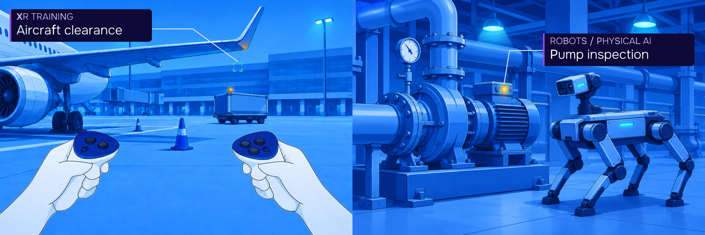

# Understand what happens in XR & Robotics

**Prove what works and what deserves more investment. Track complete sessions, explore session behaviour, and analyze aggregate insights to improve performance and scale with evidence.**

## Connect your stack

| XR | Robots & Physical AI |
| --- | --- |
| [**Unity**](https://github.com/CognitiveVR/cvr-sdk-unity) · [Setup](https://docs.cognitive3d.com/unity/minimal-setup-guide/) [**Unreal Engine**](https://github.com/CognitiveVR/cvr-sdk-unreal) · [Setup](https://docs.cognitive3d.com/unreal/get-started/) [**WebXR**](https://github.com/CognitiveVR/c3d-sdk-webxr) · [Setup](https://docs.cognitive3d.com/webxr/get-started/) | [**ROS 2**](https://github.com/CognitiveVR/c3d-sdk-ros2) · [Quickstart](https://docs.cognitive3d.com/ros2/quickstart/) [Documentation](https://docs.cognitive3d.com/ros2/get-started/) · [Workflow overview](https://cognitive3d.com/robotics-physical-ai/?utm_source=github&utm_medium=org_profile&utm_campaign=github_presence&utm_content=robotics_workflow) |

[More SDKs and supported platforms](https://docs.cognitive3d.com/)

**Capture How People and Robots Interact**  
Understand movement and input across XR and physical AI. Record motion, inputs, gaze, interventions, device metadata, and supported sensor data to review behaviour in context. [Learn about capture](https://cognitive3d.com/product/track/?utm_source=github&utm_medium=org_profile&utm_campaign=github_presence&utm_content=capture)

**Replay XR & Robotics Sessions in 3D**  
See what happened in each session with full spatial context. Replay sessions in 3D to review movement, actions, outcomes, timelines, and metrics with flexible playback controls. [Explore session replay](https://cognitive3d.com/product/explore/?utm_source=github&utm_medium=org_profile&utm_campaign=github_presence&utm_content=replay)

**Analyze XR & Robotics Behaviour**  
Understand task performance across recorded sessions. Compare navigation, attention, goal outcomes, object use, and segments to identify repeatable patterns, friction points, and improvement opportunities. [See aggregate insights](https://cognitive3d.com/product/analyze/?utm_source=github&utm_medium=org_profile&utm_campaign=github_presence&utm_content=analyze)

**Connect, Export & Access Data**  
Make spatial session data usable across your reporting tools and data pipelines. Export data as CSV, JSON, or PDF. Share screenshots or links by email. Connect LMS, BI, AI systems, and other platforms using xAPI, SCORM, REST API, MCP Server, and supported integration paths.  
[Python client](https://github.com/CognitiveVR/cognitive3dpy) · [REST API](https://docs.cognitive3d.com/api/get-started/) · [CLI](https://docs.cognitive3d.com/api/cli/getting-started/) · [MCP Server](https://docs.cognitive3d.com/mcp-server/getting-started/)

**Get help**  
For integration help, [join our Discord](https://discord.gg/x38sNUdDRH). Report bugs or request features in the relevant repository's issue tracker. Evaluating XR, robots or physical AI? [Book a demo](https://cognitive3d.com/demo/?utm_source=github&utm_medium=org_profile&utm_campaign=github_presence&utm_content=demo).
